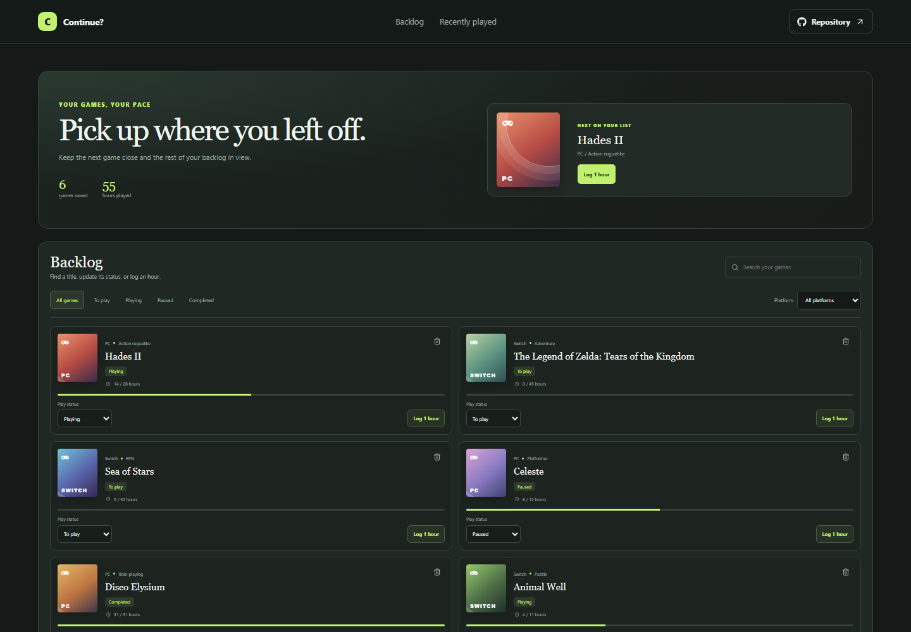

# Video Game Backlog

Continue? keeps a game backlog practical, with a clear next title, platform filters, play status, and a lightweight playtime log.

**Live site:** [https://a2rp.github.io/video-game-backlog/](https://a2rp.github.io/video-game-backlog/)

## Interface

The top card highlights the next game and summarizes saved games and logged hours. The backlog catalog can be searched and filtered by status and platform. Cards show genre, status, estimated hours, and playtime controls.

## Features and use

Add a game and choose its platform. Use the platform and status filters or search the catalog. Change Play status from a card selector. Select Log 1 hour to update playtime and progress; reaching the estimated goal marks the game complete. Remove a game with the trash button and confirm.

## Data and limits

Game details, status, estimated hours, and logged hours are stored in localStorage. New games use a 20-hour estimate. The app is a personal tracker and does not connect to game platforms.

## Run locally

Use Node.js and npm, then run these commands from the project folder:

```sh
npm install
npm run dev
```

Run ESLint and create a production build with:

```sh
npm run lint
npm run build
```

## Deployment

The public app is published with GitHub Pages. Build and publish the current version with:

```sh
npm run deploy
```

Vite builds with the /video-game-backlog/ project-page base path.

## Future improvements

These are ideas and are not implemented yet:

- Edit game metadata and customize estimated completion time.
- Add achievements, platform sync, and backlog import or export.

## Links

- Portfolio: [https://www.ashishranjan.net](https://www.ashishranjan.net)
- GitHub: [https://github.com/a2rp](https://github.com/a2rp)
- CodePen: [https://codepen.io/ash1198](https://codepen.io/ash1198)
- LinkedIn: [https://www.linkedin.com/in/aashishranjan](https://www.linkedin.com/in/aashishranjan)
- Facebook: [https://www.facebook.com/theash.ashish/](https://www.facebook.com/theash.ashish/)
- YouTube: [https://www.youtube.com/@ashishranjan-ashz?sub_confirmation=1](https://www.youtube.com/@ashishranjan-ashz?sub_confirmation=1)
- Email: [mailto:ash.ranjan09@gmail.com](mailto:ash.ranjan09@gmail.com)

## Support

- Support: [https://a2rp-donation-page.netlify.app/](https://a2rp-donation-page.netlify.app/)
- Buy Me a Coffee: [https://buymeacoffee.com/ashishranjan](https://buymeacoffee.com/ashishranjan)
- Patreon: [https://www.patreon.com/ashishranjan](https://www.patreon.com/ashishranjan)